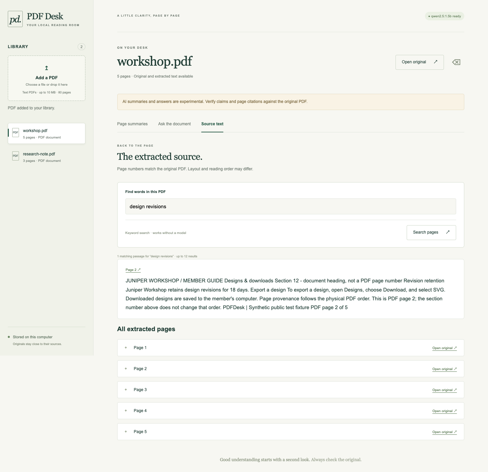

# PDF Desk

A local reading desk for text PDFs. Import a document, search its extracted passages, and open matching physical pages in the original PDF. The browser and JSON-producing CLI also offer experimental generated page summaries and question answers.



PDF Desk uses an installed **local Ollama model**, defaulting to `qwen2.5:3b`. It makes no hosted or paid API calls, requires no API key, and never downloads a model automatically. Import, list, keyword search, source-text inspection, and delete work without model access.

## Install and open the desk

Requires Python 3.11 or newer. Ollama and a locally installed model are needed for summaries and answers. Install Ollama using its [official installation instructions](https://docs.ollama.com/quickstart), then check `ollama list`. If you choose to download the default model, run `ollama pull qwen2.5:3b` separately. Start the Ollama service if it is not already running.

```sh
git clone https://github.com/Soumil-Makhija/document-summary-qa.git
cd document-summary-qa
python3 -m venv .venv
. .venv/bin/activate
python -m pip install -e '.[dev]'

# Optional: put the public synthetic guide on your shelf before opening the UI.
pdfdesk --data-dir .pdfdesk import examples/workshop.pdf
pdfdesk --data-dir .pdfdesk serve --port 8765
```

Open **http://127.0.0.1:8765**. The library accepts a chosen or dropped PDF. Select a document and use **Source text → Find words in this PDF** for keyword search and matching passages with direct page links. Search works with Ollama stopped. You can also try **Page summaries** or **Ask the document**, and inspect **Open original**. Every evidence card has the exact extracted quote and an original-page link. The model badge checks availability; readiness is not an inference test.

The included `examples/workshop.pdf` and `examples/research-note.pdf` contain invented policies and fictional research data. They are test fixtures, not real organizational guidance or scientific evidence. The workshop guide deliberately includes an untrusted instruction to exercise prompt-injection behavior.

## CLI

Run `pdfdesk --help` or `python -m pdfdesk --help`. Global options go before the command. An import prints JSON containing the document's opaque `id`; substitute that value for `DOCUMENT_ID` below.

```sh
pdfdesk --data-dir .pdfdesk list
pdfdesk --data-dir .pdfdesk show DOCUMENT_ID
pdfdesk --data-dir .pdfdesk search DOCUMENT_ID "design revisions"
pdfdesk --data-dir .pdfdesk summarize DOCUMENT_ID
pdfdesk --data-dir .pdfdesk ask DOCUMENT_ID \
  "How do I export a design, and are annual memberships refundable?"
pdfdesk --data-dir .pdfdesk delete DOCUMENT_ID

# Select a different already-installed local model or Ollama port.
pdfdesk --data-dir .pdfdesk --model qwen2.5:3b \
  --ollama-url http://127.0.0.1:11434 serve --port 8765
```

The equivalent environment defaults are `PDFDESK_DATA_DIR`, `PDFDESK_MODEL`, and `PDFDESK_OLLAMA_URL`. Model URLs must be loopback HTTP addresses without credentials or extra paths. CLI commands print JSON on success; failures go to standard error with a nonzero exit status.

`search` returns the trimmed `query` and up to 12 ranked `results`, each containing an exact indexed passage, its physical `page`, and an original-page `url`. No match returns an empty results list. This is keyword ranking: passages may match any query term, and paraphrases without shared words may be missed. Search results are source text, without an AI-generated answer.

## What the results mean

**Page summaries are extractive.** The model first classifies sentence roles, then selects up to six key source sentences per page batch. The app restores their exact original wording as the summary and cited key points; it does not invent paraphrased claims. Every page with text is processed in batches of up to five passages, and long-page batches remain under the same physical page number. Empty pages remain in the source view and produce warnings. A page with no eligible source sentences fails explicitly.

**Question answers are source extracts.** Explicit clauses joined by “and” followed by a question word are split using their original wording. Other questions reach the model unchanged. The model selects sentence identifiers and reports whether each clause has enough source support; all clauses must be supported before the app returns their exact quotes. There is no model-written question plan that can replace a qualifier. The source decision can still be wrong or falsely abstain.

Every citation includes `passage_id`, `page`, `quote`, and `url`. The service verifies the quote is an exact substring of its indexed passage and derives the physical page from that passage. Whitespace is normalized during extraction, so line wrapping and spacing can differ from the visual PDF. Page numbers are **1-based physical PDF order**, independent of printed section or page labels. Links use `/api/documents/ID/file#page=N`; their navigation behavior also depends on the browser's PDF viewer.

Quote provenance does not establish relevance, completeness, or truth. Role classification, key-sentence selection, and support decisions use the same local model and remain fallible. Compare quoted context and original pages, especially for qualifiers, tables, causality, and scientific claims. Role filtering treats assistant-directed source commands as untrusted data; it cannot guarantee immunity to every prompt injection.

## Storage, privacy, and limits

The default `.pdfdesk/` contains a SQLite index and `originals/` copies named with opaque IDs. Source pages and passage provenance survive process restarts; reopening the same `--data-dir` restores the library. Uploaded filenames are display metadata and never become filesystem paths. Delete removes the indexed document, pages, passages, and original copy from this workspace; it does not securely erase backups or browser downloads. Generated results are held in browser memory unless you save CLI output or an evaluation report.

Document text is sent to the configured local Ollama process for inference. The app uses local static assets, does not add telemetry, and does not log document text or request URLs. Model traces are bounded in process memory; the live evaluator deliberately writes source excerpts and model outputs to its chosen report. Ollama's own logging and retention configuration still apply.

| Limit | Current behavior |
| --- | --- |
| PDF bytes | At most 10 MiB per import |
| Physical pages | At most 80 |
| Extracted text | At most 2,000,000 normalized characters per document |
| Passage size | At most 1,000 characters, with page-local overlap |
| Full summary | At most 160 extracted passages; larger imports remain readable and searchable |
| Question | 1–2,000 characters |
| Retrieval | Document-local BM25-style lexical ranking, at most 12 passages |
| Small-document fallback | When lexical search finds nothing and the document has at most 12 passages, use all of them |
| Browser inference | One active request; a concurrent request receives HTTP 429 rather than waiting in an unbounded model queue |

Lexical retrieval can miss paraphrases, distributed evidence, or facts outside its top results. There are no embeddings or external knowledge searches. Summary generation and review make several model calls and may be slow on CPU; each model HTTP call has a 120-second timeout.

Supported input is an unencrypted, digitally authored text PDF. Strict PDF parsing can reject files that a tolerant viewer opens. Malformed, encrypted, page-less, oversized, and entirely image-only files are rejected. Mixed text/image documents retain empty-page numbering and show warnings. There is no OCR. Existing OCR layers can contain errors; tables, multiple columns, equations, headings, and reading order may extract imperfectly. See [pypdf's text-extraction explanation](https://pypdf.readthedocs.io/en/6.1.3/user/extract-text.html) for the underlying constraints. File and text caps are not a hard process-memory sandbox for PDF decompression.

The HTTP app is a personal loopback tool with no accounts or authentication. It binds only to IPv4 loopback, validates the exact Host and write Origin, sets no CORS permission, and caps request bodies and socket reads. Do not expose it through shared hosting or a public reverse proxy. Invalid model output, failed quote validation, truncated responses, and invalid source selections are rejected explicitly; there is no fabricated fallback answer or silent switch to a hosted provider.

## Local HTTP API

The browser uses these routes. Responses are JSON except static assets and the original PDF. Replace `ID` with a returned document identifier.

| Method | Route | Behavior |
| --- | --- | --- |
| GET | `/api/health` | App status and local model availability |
| GET | `/api/documents` | List document metadata |
| POST | `/api/documents` | Import raw PDF bytes; percent-encode the display name in `X-Filename` |
| GET | `/api/documents/ID` | Metadata and extracted text by physical page |
| DELETE | `/api/documents/ID` | Delete the local original and its index |
| GET | `/api/documents/ID/file` | Original PDF bytes |
| GET | `/api/documents/ID/passages` | Indexed page-local passages |
| GET | `/api/documents/ID/search?q=WORDS` | Up to 12 ranked source passages with exact physical-page links; no model needed |
| POST | `/api/documents/ID/summary` | JSON `{}`; generated page summaries and cited key points |
| POST | `/api/documents/ID/answer` | JSON `{"question":"…"}`; support decision, source-extract answer, evidence and retrieved passages |

The server requires `Content-Length` for POSTs, allows up to 32 KiB for JSON bodies, and rejects transfer-encoded bodies. Failures have an `error` string: 400 for invalid input, 403 for rejected Host/Origin, 404 for missing routes/documents, 413 for excessive request size, 429 for a busy model, and 502 for model access or validation errors. Unexpected internal failures return a generic 500 without private exception details.

## Tests and real-model evaluation

```sh
python -m unittest discover -s tests -v
python -m compileall -q pdfdesk tests
node tools/test_ui_state.cjs

# Uses the installed model and real synthetic PDFs; can take several minutes.
python tools/evaluate_live.py --base-url http://127.0.0.1:11434 \
  --model qwen2.5:3b --output tmp/evidence/live.json
```

Unit tests exercise real PDF extraction/storage, request protections and CLI behavior, with deterministic fake model responses for model-dependent assertions. GitHub Actions is configured for Ubuntu Python 3.11 and 3.14 and does not download or invoke a hosted model. Loopback integration tests need permission to open local sockets.

CI also builds a wheel, installs it into a fresh virtual environment, and runs `python -I tools/smoke_installed.py` with that environment's Python. This checks the installed CLI, persisted pages, packaged web assets, original-file bytes, and deletion from outside the source import path. The JavaScript state regression needs Node.js 18 or newer.

The live evaluator imports both public PDFs into a temporary persistent store, checks restart/deletion behavior, generates page summaries, and runs the manifest's supported, unsupported, multipart, qualifier, and hostile-annotation questions. It checkpoints genuine outputs, model traces, code/fixture fingerprints and citation checks to the chosen JSON file. Exit 0 means automated smoke checks passed **with manual review still required**; 1 means a failed/interrupted run; 2 means model access is blocked. Inspect the report's `status`, individual checks, outputs and review assessments. A partially completed report is useful evidence, not a successful evaluation.

**November 11 build:** extractive summaries now return all eight pages of the two original fixtures, with 207 page/citation checks passing and manual review recorded in [summary evidence](evidence/summary-review-2026-11-11.md). The new question workflow and a fresh independent fixture are undergoing real-model validation. Historical November 9 failures remain in [the earlier review](evidence/model-review-2026-11-09.md). This paragraph will be updated with the final build results.

Do not infer a model accuracy rate from these examples: they are a small synthetic regression set used during development, not an untouched holdout, and substring/citation checks do not prove factual entailment.

## Implementation

`core.py` owns pypdf extraction, normalized pages, overlapping passages, per-operation SQLite connections and lexical retrieval. `search.py` exposes validated keyword queries and physical-page links without generation. `model.py` calls local Ollama using structured JSON schemas, constrained sentence identifiers and exact-text restoration. `selection.py` preserves original question clauses and validates selected sentence IDs; `summary.py` classifies roles and selects exact key sentences. `service.py` resolves provenance and assembles page summaries and complete source-extract answers. `server.py` exposes the loopback API and packaged vanilla HTML/CSS/JavaScript UI; `cli.py` uses the same services. [Ollama's structured-output documentation](https://docs.ollama.com/capabilities/structured-outputs) describes the schema mechanism; a valid schema alone does not guarantee a correct answer.
